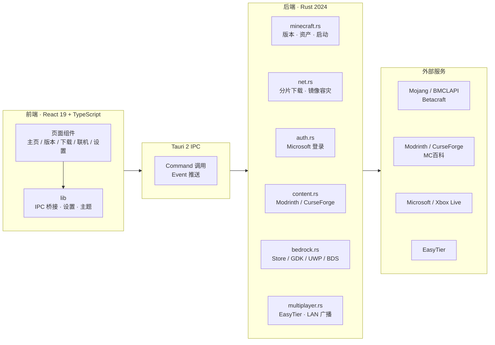

<div align="center">


<h1>Open-source-Minecraft-launcher</h1>

<p>
  <strong>轻量 · 现代 · 高性能的开源 Minecraft 启动器</strong><br />
  Java 版 × 基岩版 · 基于 Tauri 2 / Rust / React 19
</p>

<p>
  <a href="LICENSE"></a>
  
  
  
  
  
  
</p>

<p>
  <a href="#快速开始">快速开始</a> ·
  <a href="#功能特性">功能特性</a> ·
  <a href="#界面预览">界面预览</a> ·
  <a href="#技术架构">技术架构</a> ·
  <a href="#常见问题">常见问题</a> ·
  <a href="#参与贡献">参与贡献</a>
</p>

</div>

> [!NOTE]
> 当前版本 **0.0.7**，项目仍在快速迭代；功能、界面与数据格式都可能继续调整。遇到问题欢迎在 [Issues](https://github.com/Cerlesse-studio/Open-source-Minecraft-launcher/issues) 反馈。

## 目录

- [项目简介](#项目简介)
- [界面预览](#界面预览)
- [功能特性](#功能特性)
  - [启动与账户](#启动与账户)
  - [版本与实例](#版本与实例)
  - [下载引擎](#下载引擎)
  - [内容市场](#内容市场)
  - [联机](#联机)
  - [基岩版](#基岩版)
  - [个性化](#个性化)
  - [运行时与安全](#运行时与安全)
- [快速开始](#快速开始)
- [使用指南](#使用指南)
- [技术架构](#技术架构)
  - [架构总览](#架构总览)
  - [技术栈](#技术栈)
  - [项目结构](#项目结构)
- [常见问题](#常见问题)
- [已知限制](#已知限制)
- [参与贡献](#参与贡献)
- [致谢](#致谢)
- [许可证](#许可证)

---

## 项目简介

**Open-source-Minecraft-launcher** 是一个基于 **Tauri 2** 的桌面 Minecraft 启动器：前端使用 **React 19 + TypeScript**，后端使用 **Rust 2024**。它把 Java 版与基岩版的版本管理、下载、账户、模组、资源包、存档、内容市场和 EasyTier 联机收进同一个应用，目标是把「装版本、装模组、和朋友联机」变成几次点击。

项目主要针对 **Windows 10 / 11** 做完整适配；Java 版核心保持跨平台，可在 macOS / Linux 尝试构建运行，基岩版与 Xbox 运行时相关能力目前仅限 Windows。界面使用系统 WebView，而不是自带整套 Chromium；下载、解包、校验与启动编排都在 Rust 侧完成。

启动器不包含广告、遥测或捆绑组件，账户令牌只落盘在本机；代码以 [MIT License](LICENSE) 开源。

<table>
  <tr>
    <td align="center" width="33%"><b>🎮 双版本统一</b><br /><sub>Java + 基岩版<br />同一套版本库与启动入口</sub></td>
    <td align="center" width="33%"><b>⚡ 原生性能</b><br /><sub>Tauri 2 + Rust<br />系统 WebView，轻量低占用</sub></td>
    <td align="center" width="33%"><b>⬇️ 稳定下载</b><br /><sub>多线程分片<br />镜像容灾 + 断点续传</sub></td>
  </tr>
  <tr>
    <td align="center"><b>🔐 双账户体系</b><br /><sub>微软正版 / 离线账户<br />皮肤、授权、会话续期</sub></td>
    <td align="center"><b>🧩 模组生态</b><br /><sub>Forge / NeoForge / Fabric / Quilt<br />LeviLamina / Amethyst</sub></td>
    <td align="center"><b>🌐 零配置联机</b><br /><sub>EasyTier + 公网 IPv6<br />分享码一键加入</sub></td>
  </tr>
</table>

## 界面预览

<table>
  <tr>
    <td colspan="2" align="center">
      
      <br />
      <sub>主页 · Mojang 更新新闻、账户面板与一键启动</sub>
    </td>
  </tr>
  <tr>
    <td align="center" width="50%">
      
      <br />
      <sub>下载中心 · 版本 / 加载器 / 内容分类</sub>
    </td>
    <td align="center" width="50%">
      
      <br />
      <sub>设置 · 下载镜像、并发线程与界面个性化</sub>
    </td>
  </tr>
</table>

<sub>界面会随版本迭代调整，以实际运行为准。</sub>

## 功能特性

<table>
  <tr>
    <td align="center" width="50%"></td>
    <td align="center" width="50%"></td>
  </tr>
  <tr>
    <td align="center"></td>
    <td align="center"></td>
  </tr>
  <tr>
    <td align="center"></td>
    <td align="center"></td>
  </tr>
</table>

### 启动与账户

- **微软正版账户**：使用 OAuth 2.0 设备码登录，不接触密码。登录一次后同时用于 Java 会话与基岩版授权检测；刷新令牌保存到本机，启动时由后端直接读取，不经过前端。登录窗口只允许打开微软 / Xbox 官方域名，避免被重定向到伪造登录页；若内置公共客户端 ID 被微软限流，可在高级设置里填入自己注册的 Azure 应用 ID。
- **离线账户**：昵称 + 确定性 UUID；支持随机、Steve、Alex、Mojang 正版皮肤与本地自定义皮肤，可选择经典 / 纤细模型。启动器会把本地自定义皮肤打成 `OfflineSkinPack` 并写入 `options.txt` 的 `resourcePacks`；Mojang 皮肤则通过官方签名纹理注入，1.19.2 及更早版本离线进入也能显示。
- **一键启动**：自动识别版本核心与所需 Java；按版本设置内存、窗口大小 / 全屏、JVM 参数、启动语言、进程优先级、窗口标题与启动器关闭 / 隐藏行为。Java 版支持版本隔离（全部版本 / 仅模组包 / 不隔离）。
- **古老版本兼容**：BetaCraft 归档的 Classic / Indev / Infdev / Alpha / Beta 与 1.6 及更早的 Mojang 版本会过滤空的分辨率占位参数（`--width` / `--height`），只向旧模板补充它声明过的启动参数，并按需填入 LegacyFix 的窗口图标变量，避免 `Failed launch main class` 这类启动前闪退。
- **实时控制台**：游戏标准输出与错误日志实时投递到日志面板，支持 ANSI 染色与一键导出。

### 版本与实例

- **统一版本库**：版本选择页同时列出 Java 与基岩版，支持搜索和「全部 / 仅 Java / 仅基岩 / 愚人节 / 模组版本 / 正式版」筛选，显示已安装与可下载数量；每个版本可启动、打开目录、进入设置或删除。
- **版本安装**：Java 正式版、快照、愚人节版本与远古版本分别归档，远古版本来自 Betacraft 索引；安装后可继续配置 Forge / NeoForge / Fabric / Quilt / OptiFine（Forge）/ Fabric API。下载页同时提供基岩版核心，以及模组、光影、资源包、数据包与整合包等内容分类。
- **实例设置**：每个实例独立保存最大内存、窗口尺寸 / 全屏、Java 路径、JVM 参数、语言、版本隔离、进程优先级、启动器可见性与自定义信息；设置页的全局值作为默认，实例值可覆盖。
- **资源包 / 地图 / 模组管理**：Java 资源包开关直接改写 `options.txt` 的 `resourcePacks` 列表，与游戏内「选项 → 资源包」同步；存档目录随版本隔离在 `versions/<id>/saves` 与共享 `saves` 之间切换，支持 `.zip` / 文件夹导入与整份删除；模组支持启停、删除与本地导入。
- **PCL2 风格快捷方式**：Java 版概览页提供「版本文件夹 / 存档文件夹 / Mod 文件夹 / 截图文件夹」四个入口，目录不存在时自动创建。

### 下载引擎

- **多线程分片**：文件 ≥ 1 MB 时按 HTTP Range 分片，每片至少 512 KB；线程档位 1–64 可调，分片并发实际上限 16 路，单文件小于 1 MB 仍走单线程。

**自适应与重试策略**

| 场景 | 处理方式 |
| --- | --- |
| 分片启动后 12 秒内 | 低速不判失败，给镜像爬坡时间 |
| 12 秒后总吞吐持续 < 8 KB/s | 放弃分片，改用单连接继续下载 |
| 单个分片 30 秒收不到字节 | 判定连接失效，重试或回退 |
| 镜像返回 `429` / `503` | 退避后逐个补齐剩余分片，避免整体失败 |
| 文件 < 1 MB | 直接单线程 |
| 分片 < 512 KB | 合并分片，避免过度切分 |

- **镜像容灾**：候选地址覆盖官方 / 亚太 Anycast CDN、BMCLAPI、Forge / NeoForge / Fabric / Quilt Maven、Betacraft 旧版本资源、GitHub 加速镜像与 10 个 Xbox Live CDN 主机；遇到 404、超时或连接失败会自动换源。自定义镜像按 BMCLAPI 兼容路径重写，并校验必须为 `http(s)` 地址。
- **测速与真实生效**：设置里的「测速」会分别请求官方、BMCLAPI（配置了自定义源时也包括自定义源）的版本清单，显示首字节延迟与「最快」标记，可一键切换；所选下载源会下发到 Rust，实际改变版本清单与游戏文件的候选顺序，失败仍自动回退。
- **断点续传**：内核安装等任务通过 `.part.meta` 记录分片布局与完成情况，`.part` 不会在失败或换镜像时被删除；已下好的分片不会重复拉取，只有旁车文件与 `.part` 对不上时才自动重来。暂停、恢复、取消与关闭应用都会保留断点。
- **统一下载管理**：版本安装、等待队列、历史记录与 EasyTier 内核任务都在下载管理器中显示实时进度、速度、线程数、阶段与失败重试；离开页面或在下载页切换标签不会中断后端任务。
- **内容同引擎**：Java 模组、资源包、光影、数据包以及基岩版附加包的下载都走统一的 `download_file_with_mirrors`（分片并发、原子 `.part` 写入、SHA-1 校验、镜像回退），并沿用设置里的并发线程数与下载源。

### 内容市场

- **Java 内容**：接入 Modrinth，搜索模组、整合包、光影、资源包与数据包；可按游戏版本、加载器（Fabric / Forge / NeoForge / Quilt）和下载量 / 更新时间排序。
- **基岩版内容**：接入 CurseForge 基岩版目录（`gameId=78022`，附加包 `classId=4984`，材质包 `classId=6929`），搜索后直接下载并按附加包规则解包安装。
- **多语言搜索**：模组、整合包、光影、数据包与基岩版附加包的搜索框接受中文（含繁体）、日文、韩文与俄文关键词。后端 [search_i18n.rs](src-tauri/src/search_i18n.rs) 把「钠」「机械动力」「光影」「シェーダー」「셰이더」「шейдер」等术语映射成英文再查询，例如「钠」→ `sodium`、「机械动力 附属」→ `create addon`；若换用英文后一条结果也没有，会自动回退到原始关键词，所以标题本身就是中文的项目不会被藏起来。搜索框下方会显示实际使用的英文关键词，替换过程完全可见。
- **版本类型搜索**：版本下载页的搜索框同样支持类型关键词：正式版 / 快照 / 愚人节 / Beta / 远古 / `release` / `snapshot` 等（中英文均可），April Fools 构建不会被「快照」搜索结果混入。

**安装落点**

| 内容类型 | 安装位置 |
| --- | --- |
| Java 模组 | `versions/<匹配实例>/mods` |
| Java 光影 / 资源包 / 数据包 | 优先 `versions/<匹配实例>/shaderpacks` / `resourcepacks` / `datapacks`；无匹配实例时退回根目录同名文件夹 |
| Java 整合包 | `<游戏目录>/modpacks`（下载归档，不自动展开安装） |
| 基岩版附加包 / 材质包 | 所有已存在的 `com.mojang` 数据目录，按 `manifest.json` 分类 |

下载 Java 模组时会自动挑选游戏版本（以及加载器）一致的本地实例，直接写入 `versions/<实例>/mods`。模组不再有「根目录 `mods/`」这个公共落点：那个目录游戏读不到，只会让人以为装好了却失效。每行右侧会直接显示落点（`<实例>/mods`）；本机没有对应版本时该行标注 `需先安装 <版本>` 并禁用下载按钮，装好版本后即可下载。旧版本留下的根目录 `mods/` 不再被读取或写入，空目录会自动清除。

**版本选择与分组**：版本选择页采用「版本胶囊 + 折叠分组」布局。顶部胶囊列出该项目支持的所有大版本（`全部` 与 `1.21`、`1.20` 等，点击即筛选，带本地已安装版本的分组默认展开），下方按 **加载器 + 游戏版本** 折叠分组（如 `NeoForge 1.21.4`，预发布 / 快照构建单独归入带 `预览版` 后缀的分组，且排在正式分组之后）。每个构建一行，显示 `模组名 版本 for 加载器 版本`、文件名、下载次数、更新时间、文件大小，测试版 / 预览版会额外标注渠道。

项目头部的快捷操作会跟随数据源变化：

| 数据源 | 按钮 |
| --- | --- |
| Modrinth（Java 模组 / 整合包 / 数据包 / 光影 / 材质） | **转到 Modrinth** · **转到 MC 百科**（模组、整合包、数据包）· **复制名称** |
| CurseForge（基岩版附加包 / 材质包） | **转到 CurseForge** · **复制名称**（MC 百科没有基岩版条目，自动隐藏） |

**转到 MC 百科** 不再只是丢一个搜索页：后端 [mcmod.rs](src-tauri/src/mcmod.rs) 会按 PCL2 的思路定位具体条目 ID（`/class/<id>.html` 或 `/modpack/<id>.html`），只接受英文名、方括号缩写或整个标题与项目 slug 完全一致的结果（因此 `Sodium` 不会误跳到 `Sodium Extra`，`Create` 也不会跳到它的附属），查不到时才退回 `search.mcmod.cn` 并标注「在 MC 百科搜索」。查询只在该页面打开时进行一次，结果按会话缓存。

桌面端的外链由 `open_url` 命令交给系统浏览器（仅允许 `http/https`，失败时按平台回退到 `start` / `open` / `xdg-open`），浏览器预览则新开标签页；**复制名称** 优先用剪贴板 API，被 WebView 拒绝时回退到隐藏文本框方案。

**CurseForge 接口**：

| 用途 | 接口 |
| --- | --- |
| 搜索项目 | `GET {base}/v1/mods/search?gameId=78022&classId=…&searchFilter=…&sortField=…&index=…&pageSize=…` |
| 文件列表 | `GET {base}/v1/mods/{modId}/files?index=0&pageSize=50` |
| 下载直链 | 文件记录中的 `downloadUrl`，缺失时回退 `GET {base}/v1/mods/{modId}/files/{fileId}/download-url` |

`{base}` 默认使用免密钥镜像 `https://mod.mcimirror.top/curseforge/`；配置环境变量 `CURSEFORGE_API_KEY`（或 `COBBLE_CURSEFORGE_API_KEY`）后会优先使用官方 `https://api.curseforge.com/`（携带 `x-api-key`）。下载的文件按附加包规则解包安装，因此搜索 → 选文件 → 安装全程无需打开浏览器或 Microsoft Store。

### 联机

联机功能以内置的 [EasyTier](https://easytier.cn) v2.6.4 为内核，用公网 IPv6 做点对点直连，不依赖中转服务器。启动器负责下载内核、分配虚拟地址、生成分享码、把好友世界广播到局域网列表，并在关闭时清理进程。

#### 三步开房

1. **装内核**：双方进入「联机」页安装 EasyTier 内核。任务由后端持有，切页、重启启动器都可继续下载。
2. **创建房间**：房主先选一个已安装的房间版本（必选）和本机的公网 IPv6 入口；进入游戏后点「对局域网开放」，启动器会从本次 `logs/latest.log` 自动读取端口并生成 `cobble-mp://join?...` 分享码。版本隔离时日志目录也会跟着切换。
3. **加入房间**：好友粘贴整段分享码加入，打开游戏「多人游戏 → 局域网」即可看到世界；也可以手动直连房间页给出的 `10.126.126.x:端口`。

#### 连接与分享码

- 分享码格式为 `cobble-mp://join?name=…&secret=…&peer=…&ip=…&port=…&res=…&rt=…`，把网络标识、密钥、房主入口地址、虚拟地址、世界端口和房间资源列表入口打包成一段文本，好友整段粘贴即可切换网络、自动填入对端并启动节点。
- 房主监听 `tcp://[::]:11010` / `udp://[::]:11010`；访客把房主公网 IPv6 作为唯一初始对等节点，分享码里不包含任何中转节点。
- 每台机器固定使用 `10.126.126.x` 网段（与 MCTier 相同的约定）。加入时若与自己的地址撞车会自动改号，避免整个网段异常。
- `name` 只是 EasyTier 的内部网络标识，藏在分享码里；界面不再展示、也不需要填写。真正建立连接的是 `peer` 里的房主公网 IPv6。
- 启动器会检测本机的公网 IPv6 并列出可选入口（非公网地址会禁用），点一下就能作为房主入口。路由器 / 光猫那层无法由启动器修改，界面会直接给出要放行的协议、端口和目标 IPv6。

#### 局域网发现

- 用 Minecraft Server List Ping 读取好友世界的 MOTD、版本、人数和延迟。
- 点「显示到局域网」后，[multiplayer.rs](src-tauri/src/multiplayer.rs) 会在 `127.0.0.1` 上开一个 TCP 代理，并持续向 `224.0.2.60:4445` 与 `127.0.0.1:4445` 发送 `[MOTD]…[/MOTD][AD]…[/AD]`，好友的世界因此直接出现在「多人游戏 → 局域网」里，也可以复制 `127.0.0.1:<端口>` 手动直连。
- 世界端口修改后会立即写进分享码，不用重启网络；访客拿到新的分享码即可连接。

#### 房间与成员

- 房间页顶部直接给出在游戏里「多人游戏 → 直接连接」要填的 `虚拟地址:端口`；分享码、房间资源、在线成员、权限管理、访客的世界列表和日志都排在同一页。共享版本只在创建房间时确认，版本、模组、资源包与地图的调整仍回到版本设置页。
- **房间资源**：创建房间时必须选版本；房主启动器会扫描该版本的模组、光影包和资源包，在房间页按三列展示。房主通过本机只读 HTTP 接口提供一份 JSON 快照，访客经 EasyTier 虚拟网络读取，因此所有成员看到的是同一份清单。接口只接受分享码里的随机令牌，只返回文件名、启停状态和大小，不暴露本机路径；房主离开房间或退出启动器时服务随之结束。
- 在线成员列出 EasyTier 实际看到的设备：主机名、虚拟 IP、延迟和 `p2p` / `relay` 链路类型；列表每 5 秒自动刷新，断开网络后立即清空。内核的 RPC 管理端口每次启动由系统临时分配、只绑 `127.0.0.1`，不会和 MCTier 常用的 `15888` 抢端口，也不会暴露给房间里的其他人。
- 内核只活在启动器进程里（关掉启动器、或启动游戏时把窗口交给游戏都会结束它），但房间本身——密钥、房主入口——都写在配置里。开过一间房后会在本地记下角色和房主入口，只要房间没解散，重进联机页就直接回到房间页；内核没跑时房间页会显示「网络已断开」和重连按钮。
- 房主已经关房则停掉本机内核、清掉房间记录并留在首页提示「房间已关闭」，不会反复被带回一个连不上的房间。在房间页点「返回」后，首页顶部会给出「上次的房间还在」，一个按钮按原来的密钥重开（房主：分享码不变，旧分享码继续能用）或重连房主（访客）。只有主动点「离开房间」才算解散，意外掉线不会把房间记录丢掉。
- 内核安装任务由后端持有（`get_multiplayer_install_state` + `multiplayer:install` 事件），离开联机页或在下载管理器里切换页面都不会中断；重进联机页会读回真实进度，不会再次提示「重新下载」。解压时连同 `wintun.dll`、`WinDivert64.sys` 一起装上，TUN 虚拟网卡才能正常创建。
- 分片布局和已完成的分片记在 `<游戏目录>/easytier/easytier-core.zip.part.meta`，任务本身记在 `install-state.json`。关掉启动器、重启或换一条镜像后再点「继续下载」，只会补下没完成的那几段；下载中被打断的任务下次启动会显示成「上次下载未完成」，而不是重头下。

#### 权限与排障

- **权限管理**：能轮换网络密钥（正在玩的访客立即掉线、旧分享码作废）、给访客设总带宽上限（落成内核的 `--instance-recv-bps-limit`）。EasyTier 靠网络密钥鉴权，要立即清场就轮换密钥。
- **IPv6 防火墙**：Windows 上可一键写入入站规则：只允许 `easytier-core.exe` 在 TCP/UDP 监听端口上通行，房主的 Minecraft 端口和启动器的房间资源接口则只对虚拟地址 `10.126.126.x` 放行，不会把游戏或资源清单暴露到公网 IPv6；规则对所有网络配置文件生效，家庭网络被标成「公用」也能直连。需要管理员权限时走一次 UAC；取消授权不会改动现有规则，下次点放行会重新覆盖。
- **运行权限**：EasyTier 创建虚拟网卡需要管理员权限（Windows 下 UAC，Linux 需要 `CAP_NET_ADMIN`）。内核的 stdout/stderr 会实时投递到房间页的「日志」面板，可以据此判断是权限、端口占用还是防火墙问题。关闭启动器时会主动结束内核进程与全部局域网广播。

### 基岩版

基岩版模块面向 Windows 10 / 11，支持商店客户端、`.msixvc` GDK 加密包、UWP / AppX 与 BDS 独立核心。

#### 核心与依赖

- **首次启动依赖自检**：所有基岩版启动路径（商店客户端、`.msixvc` 加密包、AppX、BDS 独立核心）都会在启动前自检运行依赖；Xbox GDK 路径会通过 winget 自动静默补齐「Xbox 应用」与「游戏服务」，随后直接唤起游戏，无需手动排查。
- **UWP / AppX 核心不经过 Microsoft Store**：下载得到的 UWP 核心由启动器自行解包，并按 BedrockBoot 的方式以开发模式在本机注册（`Add-AppxPackage -Register`，不带 `-DisableDevelopmentMode`），随后按应用标识唤起游戏；本机未安装的框架依赖会被自动跳过，不再回退到 `minecraft:` 协议或弹出商店安装页。安装包内的原始清单会保留为 `AppxManifest.factory.xml`。
- **Xbox GDK 加密包自动接管**：选中 `.msixvc` 加密核心时不再报错阻塞，启动器会自动探测并补齐运行依赖，随后直接唤起商店版客户端；若 winget 缺失或安装被拦截，会自动打开对应商店安装页。
- **90+ 条官方 Xbox Live CDN 直链**：集成高带宽原生直链，覆盖正式版与预览版，支持极速下载安装。BDS 版本源可在 EndstoneMC、MCServerJars 与 Azure CDN 镜像之间切换。
- **离线账户核心策略**：离线账户启动基岩版时优先使用已安装的 BDS 独立核心；若只下载了 UWP / AppX 或 GDK 核心，则直接注册并唤起对应客户端（GDK 加密包自动补齐 Xbox 运行环境），不再强制改用 BDS；本机完全没有核心时才自动后台部署 BDS，无需手动选版本。
- **多实例并存**：下载的 UWP / AppX 核心会以开发模式注册并直接启动，商店版 UWP 正版同样一键唤起，也可运行版本隔离的 AppX / BDS 独立核心。

#### 附加包与存档

- **附加包自动部署（对齐 BedrockBoot-DM）**：原生支持 `.mcpack` / `.mcaddon` / `.mcworld`。安装时逐个读取包内 `manifest.json`，按模块类型（`resources` → `resource_packs`，`data` / `script` → `behavior_packs`）分区解压，文件夹以「包名 + UUID」命名避免同名覆盖；`.mcaddon` 内嵌的 `.mcpack` 会递归安装，`.mcworld` 通过 `level.dat` 识别并导入 `minecraftWorlds`。安装结果会写入所有已存在的游戏数据目录（启动器便携目录、GDK `%APPDATA%\Minecraft Bedrock`、UWP `LocalState`），不再触发 Microsoft Store 的 `.mcpack` 文件关联。
- **附加包管理器**：选中基岩版后，版本设置里的「附加包管理」不再打开 Java 的 `versions/<id>/mods`，而是直接扫描所有已存在的 `com.mojang` 数据目录（便携目录 / GDK / UWP），按资源包、行为包、皮肤包、世界模板分组，展示 `manifest.json` 里的名称、UUID、版本、简介与 `pack_icon.png` 图标。停用会把包移动到同目录的 `cobble_disabled_packs`（游戏不再加载、文件仍然保留），另支持批量启停、删除（仅限包目录内部路径）以及 `.mcpack` / `.mcaddon` / `.mcworld` / `.zip` 的本地导入——导入复用与下载安装相同的解包逻辑，写入每一个已存在的数据目录。
- **地图管理**：从每个 `com.mojang` 读取 `minecraftWorlds`，支持 `.mcworld` 导入与整份删除，删除时会清理所有数据目录中的副本。

#### 加载器与 DLL 模组

- **LeviLamina 模组加载器**：接入官方 `levilamina-client-version-db` 数据库，自动匹配并一键下载部署官方最新或指定版本的 LeviLamina 加载器。
- **Amethyst 客户端加载器**：支持原生 C++ 客户端 Mod 注入框架。
- **原生 DLL 模组管理（DllMods）**：遵循 BedrockBoot 目录与配置规范，支持原生 `.dll` 模组、LeviLamina 插件与行为包的一键启停（`.disabled` 切换）、删除与本地导入。

### 个性化

- **主题与强调色**：深色 / 浅色 / 跟随系统；强调色只有一个自定义取色器（HEX 输入或调色板），不再提供预设色卡。
- **背景与透明度**：只有「无背景」与「自定义图片」两档，不再附带预设壁纸。选本地图片或网络 URL 作为窗口壁纸，模糊度（0–24px）与背景不透明度（10–100%）实时生效；背景层固定在窗口本身而不是滚动容器内，因此在设置页往下滚动后再换图也能立即看到变化。界面不透明度（30–100%）作用于全部界面表面（卡片、侧边栏、标题栏、弹窗、输入框与下拉菜单）：所有面板颜色都由 `--surface-alpha` 统一派生，壁纸因此能透过每一层组件显示，而不只是主区域。下拉菜单、选择器与 tooltip 这类浮层不参与淡出，始终使用实色 `--popover`，否则选项后面的表单文字会透出来；窗口本身仍有不透明底层，不会透出桌面。
- **排版与文案**：字体可选现代极简（Geist Sans）、复古像素（Silkscreen）、系统原生或古典衬线，并支持界面字重（400 / 500）、字间距（紧凑 / 标准 / 宽松）与平滑过渡动画开关；启动器窗口标题、个性标语、首页状态文案、启动按钮文案与游戏窗口标题都可自定义，留空即用默认措辞。
- **自定义主页**：内置「Mojang 更新新闻」「空白」「读取本地文件」「联网更新」四种模式。本地与联网模式支持 HTML 或 PCL2 的 `.xaml` 主页，兼容 Grid / StackPanel / Border / TextBlock / Image 等布局和 MyCard、MyButton、MyHint、MyTextBox 等 PCL 控件，以及 `{DynamicResource}` 主题色与 EventType 动作（打开网页 / 复制文本 / 刷新主页 / 启动游戏）；无法还原的元素会在主页标题旁标记。联网模式可设置自动刷新间隔。
- **布局**：无边框窗口 + 自定义标题栏，侧边栏可折叠，窗口最小尺寸 1020 × 680。

### 运行时与安全

- **Java 运行时**：启动前根据 Minecraft 版本规范自动匹配系统已安装的 Java 版本；首次启动若缺失对应 Java，会自动下载并部署 Eclipse Temurin JRE 到 `<游戏目录>/runtime/` 后继续启动。也可以在设置或版本设置里手动指定 Java，支持版本级覆盖。
- **账户安全**：微软登录采用官方 OAuth 2.0 设备码流程，不收集密码；刷新令牌保存在应用配置目录的 `account.json`，Unix 平台设置为 `0600` 权限。Java 会话令牌由后端在启动时直接读取，不经过前端传输。
- **链接与文件**：外链只允许 `http/https`；基岩版包的删除限制在包目录内部；启动器没有广告、遥测或捆绑安装。
- **关于页面**：展示当前版本、操作系统与架构、Tauri 原生 / Web 预览运行模式，以及核心开源项目、数据与镜像来源；图标随包内置，离线也能显示。

---

## 快速开始

### 系统要求

| 项目 | 要求 |
| --- | --- |
| 操作系统 | **Windows 10 / 11 x64**（推荐，功能完整）；macOS / Linux 可尝试构建运行 Java 版 |
| Node.js | 20.19+ 或 22.12+ |
| Rust | stable，1.85+（项目使用 edition 2024） |
| Tauri 2 系统依赖 | Windows WebView2；macOS Xcode Command Line Tools；Linux 的 WebKitGTK 等依赖，见 [Tauri 前置条件](https://v2.tauri.app/start/prerequisites/) |
| 网络 | 首次安装版本、依赖和 Java 需要联网 |
| 其他 | 基岩版需要 Windows 10 / 11；联机需要公网 IPv6 |

### 获取构建

- **预编译包**：优先查看 [GitHub Releases](https://github.com/Cerlesse-studio/Open-source-Minecraft-launcher/releases)。仓库有对应平台构建时可直接下载；如果暂时没有，请按下面的源码构建。
- **源码**：适合想体验最新代码、参与开发，或需要自行定制的情况。

### 源码运行

```bash
git clone https://github.com/Cerlesse-studio/Open-source-Minecraft-launcher.git
cd Open-source-Minecraft-launcher
npm install
npm run tauri dev
```

> [!TIP]
> 如果 Windows PowerShell 提示「无法加载 npm.ps1，因为在此系统上禁止运行脚本」，可以改用 `npm.cmd run tauri dev`，或在 `cmd` 中执行 `npm run tauri dev`。

### 构建安装包

```bash
npm run tauri build
```

打包产物输出在 `src-tauri/target/release/bundle/`，按平台生成 MSI / NSIS、DMG 或 deb / AppImage 等格式。首次构建需要编译全部 Rust 依赖，耗时会明显长于日常开发。

### 测试与检查

```bash
# 前端类型检查 + 生产构建
npm run build

# Rust 单元测试
cargo test --manifest-path src-tauri/Cargo.toml
```

可选的下载 / 启动冒烟测试（会真实下载并尝试启动游戏，请确保本地 Java 可用）：

```bash
cargo run --manifest-path src-tauri/Cargo.toml --example smoke -- 1.8.9
```

### 首次使用

| 步骤 | 操作 |
| --- | --- |
| 1 | 启动后确认游戏目录，默认是 `~/.cobble`，也可以选择其他位置 |
| 2 | 在账户面板选择离线昵称，或登录 Microsoft 账户 |
| 3 | 进入「下载 → 游戏版本」，选择 Java 或基岩版；Java 版可继续配置加载器 |
| 4 | 启动器自动匹配 Java；缺失时会下载 Temurin JRE |
| 5 | 在「版本设置」调整内存、窗口、JVM 参数；在「设置 → 个性化」换主题与壁纸 |
| 6 | 回到主页点「启动游戏」；需要联机时进入「联机」页开房或加入 |

---

## 使用指南

### 常用入口

| 我想…… | 去哪里 |
| --- | --- |
| 安装 Minecraft Java 版 | 下载 → 游戏版本 |
| 安装 Forge / NeoForge / Fabric / Quilt | 下载 → 游戏版本 → 选择版本后配置加载器 |
| 安装基岩版核心 | 下载 → 游戏版本 → 基岩版核心 |
| 管理已安装版本 | 主页 / 版本设置 → 版本选择 |
| 调整内存 / 窗口 / JVM 参数 | 版本设置 → 启动设置（或 设置 → 游戏与启动） |
| 安装模组 / 光影 / 资源包 / 数据包 | 下载 → 对应内容分类；或版本设置 → 模组 / 资源包 |
| 导入本地基岩版附加包 | 下载 → 基岩版内容分类 → 导入本地包 |
| 和朋友联机 | 联机 → 创建房间 / 加入房间 |
| 换主题、壁纸、字体 | 设置 → 个性化 |
| 查看 Java、版本与致谢 | 设置 → 关于启动器 |

### 数据目录

默认游戏目录为 `~/.cobble`（Windows 下通常是 `C:\Users\<用户名>\.cobble`），可以在设置中修改。常见结构如下：

```text
~/.cobble/
├── assets/                  # 游戏资源（音效、语言、贴图）
├── libraries/               # Java 依赖库
├── meta/                    # 版本清单缓存
├── versions/                # 各版本核心与实例
│   └── <版本或实例>/
│       ├── mods/
│       ├── resourcepacks/
│       ├── saves/
│       └── logs/
├── saves/                   # 未启用版本隔离时的共享存档
├── resourcepacks/           # 共享资源包
├── shaderpacks/
├── datapacks/
├── modpacks/                # 从内容市场下载的整合包
├── runtime/                 # 自动下载的 Temurin JRE
│   └── temurin-<major>/
├── easytier/                # EasyTier 内核、安装状态与断点
│   ├── easytier-core(.exe)
│   ├── install-state.json
│   └── ...
└── bedrock/
    ├── versions/            # UWP / AppX / BDS 核心
    ├── games/com.mojang/    # 便携数据目录
    └── cache/               # 基岩版下载缓存
```

目录会按实际使用的功能逐步创建，不需要手工维护。账户文件不在游戏目录里，而是位于应用配置目录（Windows 通常为 `%APPDATA%\com.opensource.minecraft.launcher\account.json`），因此切换游戏目录不会退出登录。

### 备份与迁移

- **备份**：复制整个游戏目录即可，存档、模组、资源包与游戏内配置都在里面；启动器设置与账户在应用自己的数据目录，建议按需单独备份 `account.json`。
- **迁移**：把旧目录复制到新位置，在设置里把游戏目录指向新路径。启动器不会自动搬移旧数据，确认新目录可用后再删除旧目录。
- **卸载**：删除应用本体即可；如需彻底清理，再删除游戏目录和账户配置目录。删除前请先备份存档。

---

## 技术架构

### 架构总览

整体分为四层：**React 前端 → Tauri IPC → Rust 后端 → 外部服务**。



### 技术栈

| 层级 | 技术 | 职责 |
| --- | --- | --- |
| 桌面容器 | Tauri 2 | 原生窗口、进程管理、IPC、打包 |
| 前端 | React 19 · TypeScript 6 · Vite 8 | 页面与交互 |
| UI | Tailwind CSS 4 · Radix UI · Lucide · Sonner | 样式、组件原语、图标、通知 |
| 后端 | Rust 2024 · tokio · reqwest · serde | 下载、安装、启动、账户、联机 |
| 存储 | 本地文件系统 + JSON | 版本、配置、账户、存档与缓存 |

设计上，Rust 负责耗时与关键状态相关的工作：版本清单解析、分片下载、镜像回退、启动参数拼装、基岩版解包注册、EasyTier 进程与局域网广播。前端主要负责展示与下发命令；下载任务挂在后端，切换页面不会中断。

### 项目结构

```text
.
├── src/                          # React 19 前端
│   ├── App.tsx                   # 视图编排、下载队列、启动状态
│   ├── components/               # 页面与功能区
│   │   ├── HomeView.tsx          # 主页 / 更新新闻 / 快速启动
│   │   ├── VersionSelectView.tsx # Java + 基岩统一版本库
│   │   ├── DownloadCatalogView.tsx # 下载中心（版本 / 内容）
│   │   ├── DownloadsView.tsx     # 下载管理与实时进度
│   │   ├── Multiplayer*.tsx      # EasyTier 联机与房间
│   │   ├── SettingsView.tsx      # 全局设置
│   │   ├── VersionSettingsView.tsx # 实例设置
│   │   ├── Bedrock*.tsx          # 基岩版包 / 加载器管理
│   │   └── ui/                   # shadcn/ui 基础组件
│   └── lib/                      # 类型、IPC、设置、主题、PCL2 主页
├── src-tauri/                    # Rust 后端
│   ├── src/
│   │   ├── lib.rs                # Tauri 命令注册与共享状态
│   │   ├── minecraft.rs          # Java 版本、资产、启动
│   │   ├── loaders.rs            # Forge / NeoForge / Fabric / Quilt / OptiFine
│   │   ├── net.rs                # 分片下载、镜像容灾与断点续传
│   │   ├── auth.rs               # 微软设备码登录与账户存储
│   │   ├── java.rs               # Java 检测与 Temurin 部署
│   │   ├── content.rs            # Modrinth 内容搜索与下载
│   │   ├── bedrock.rs            # 基岩版核心、依赖、包与加载器
│   │   ├── bedrock_store.rs      # CurseForge 基岩版目录
│   │   ├── mcmod.rs              # MC 百科条目解析
│   │   ├── multiplayer.rs        # EasyTier、虚拟网络与局域网广播
│   │   └── search_i18n.rs        # 多语言搜索词表
│   ├── examples/smoke.rs         # 无头下载 / 启动冒烟测试
│   ├── capabilities/             # Tauri 权限配置
│   └── tauri.conf.json
├── docs/                         # 官网（index.html）、截图与功能图
├── public/                       # 图标、字体与静态资源
├── package.json
├── vite.config.ts
└── README.md
```

`docs/` 同时是官网根目录，入口为 [`docs/index.html`](docs/index.html)；将 GitHub Pages 的发布目录设为 `/docs` 即可部署。

---

## 常见问题

<details>
<summary><b>需要正版账号吗？</b></summary>

不强制。离线账户可以启动单人与离线服务器；微软账户登录后可获得正版 Java 会话、皮肤与基岩版授权检测。启动器不会要求输入微软密码，登录在微软官方页面完成。

</details>

<details>
<summary><b>没有安装 Java，或者 Java 版本不匹配怎么办？</b></summary>

启动器会按版本元数据匹配 Java 主版本；找不到时自动下载 Temurin JRE 到 `<游戏目录>/runtime/`。也可以在「设置 → 游戏与启动」或版本设置里手动指定 Java。首次下载 JRE 需要联网。

</details>

<details>
<summary><b>基岩版一定要安装 Microsoft Store 吗？</b></summary>

不必须。启动器支持 UWP / AppX 以开发模式注册、`.msixvc` GDK 核心与 BDS 独立核心；商店客户端只是其中一种来源。GDK 路径会通过 winget 补齐 Xbox 应用与游戏服务，过程中可能需要网络和管理员权限。

</details>

<details>
<summary><b>联机需要公网 IPv6 吗？没有怎么办？</b></summary>

当前设计是公网 IPv6 点对点直连，不内置中转节点。双方都需要可用的公网 IPv6；没有的话启动器无法直接连通。房主还需要放行 TCP / UDP `11010` 与 Minecraft 世界端口，路由器 / 光猫一侧要自行做对应放行。

</details>

<details>
<summary><b>下载慢、镜像 404 或经常中断怎么办？</b></summary>

先在「设置 → 下载与网络」里测速并切换到更快的源，线程数建议 8–16。镜像对高并发限速时，启动器会自动退回单连接；大文件支持断点续传。遇到 404 会自动尝试备用镜像，若某个源长期不可用，可以换回官方 / 亚太 CDN 或 BMCLAPI。

</details>

<details>
<summary><b>游戏数据、账户和设置在什么位置？</b></summary>

游戏数据默认在 `~/.cobble`（可在设置中修改），账户文件在应用配置目录的 `account.json`。界面设置保存在 WebView 本地存储中。迁移时复制整个游戏目录并在设置里指向新位置即可，账户不需要跟着搬。

</details>

<details>
<summary><b>Windows 提示「未知发布者」或要求管理员权限？</b></summary>

当前构建可能没有代码签名，SmartScreen 会提示未知发布者；请核对下载来源，或从源码自行构建。EasyTier 创建虚拟网卡、写入 Windows 防火墙规则需要管理员权限，会走 UAC；取消授权不会修改现有规则。

</details>

<details>
<summary><b>macOS / Linux 可以用吗？</b></summary>

Java 版核心保持跨平台，可在 macOS / Linux 尝试构建运行；基岩版、Xbox 运行时、winget 与 Windows 防火墙集成仅限 Windows。macOS / Linux 尚未做完整回归测试，遇到问题欢迎反馈。

</details>

<details>
<summary><b>启动失败怎么排查？</b></summary>

先看主页 / 版本设置里的实时日志，确认 Java 主版本、游戏目录权限、版本隔离与模组冲突；旧版本注意 LegacyFix 相关参数。仍然无法解决时，请附上日志、系统信息和复现步骤提 Issue，不要粘贴账户令牌。

</details>

---

## 已知限制

- **基岩版仅限 Windows**：商店客户端、GDK、UWP / AppX 注册、winget 与 Xbox 运行时都依赖 Windows。
- **联机依赖公网 IPv6**：启动器不内置中转节点，也不修改路由器 / 光猫；没有公网 IPv6 时需要自行解决网络入口。
- **预编译包可能缺失或未签名**：仓库不保证每个提交都有安装包；Windows 可能提示未知发布者，macOS 可能提示无法验证开发者。
- **第三方服务可用性**：Modrinth、CurseForge、MC 百科、BMCLAPI、Betacraft、Xbox CDN 等接口或镜像由第三方提供，可能限流、变更或不可用。
- **macOS / Linux 未完整验证**：Java 版可尝试运行，但基岩版与部分系统集成不可用。
- **PCL2 主页为部分兼容**：无法还原的 XAML 元素会在主页标题旁标记，未支持的动作会提示「暂不支持」。
- **EasyTier 版本固定**：当前固定 v2.6.4，升级内核需要随启动器更新。

---

## 参与贡献

欢迎提交 Issue、Pull Request、文档改进与翻译。

1. Fork 仓库并从 `main` 创建分支，分支名建议使用 `feat/…`、`fix/…` 或 `docs/…`。
2. 保持改动聚焦；较大的功能或行为变更请先开 Issue 讨论。
3. 提交前运行检查：

```bash
npm run build
cargo fmt --manifest-path src-tauri/Cargo.toml -- --check
cargo clippy --manifest-path src-tauri/Cargo.toml --all-targets -- -D warnings
cargo test --manifest-path src-tauri/Cargo.toml
```

4. UI 改动请附截图；行为变更请同步更新 README 或相关注释。
5. 不要提交 `node_modules/`、`dist/`、`src-tauri/target/`、日志文件或 `.tmp/` 下的临时产物。

提交 PR 即表示同意以本项目的 MIT 许可证发布你的贡献。涉及账户令牌、命令执行或本地文件边界的安全问题，请避免在公开 Issue 中粘贴敏感信息。

---

## 致谢

启动器能跑起来，离不开这些开源项目与数据服务：

| 项目 | 用途 | 许可证 |
| --- | --- | --- |
| [Tauri 2](https://github.com/tauri-apps/tauri) | 桌面运行时与打包 | MIT / Apache-2.0 |
| [Rust](https://www.rust-lang.org) | 后端语言 | MIT / Apache-2.0 |
| [React](https://github.com/facebook/react) | 界面框架 | MIT |
| [Vite](https://github.com/vitejs/vite) | 构建工具 | MIT |
| [Tailwind CSS](https://github.com/tailwindlabs/tailwindcss) | 样式引擎 | MIT |
| [Radix UI](https://github.com/radix-ui/primitives) | 组件原语 | MIT |
| [Lucide](https://github.com/lucide-icons/lucide) | 图标 | ISC |
| [Sonner](https://github.com/emilkowalski/sonner) | 通知提示 | MIT |
| [Geist / Silkscreen](https://github.com/vercel/geist-font) | 界面字体 | SIL OFL 1.1 |
| [EasyTier](https://github.com/EasyTier/EasyTier) | 联机内核 | LGPL-3.0 |
| [BedrockBoot-DM](https://github.com/0x44614D696E67/BedrockBoot-DM) | 基岩版核心与加载规范参考 | GPL-3.0 |

数据与镜像来源：

| 来源 | 用途 |
| --- | --- |
| [Mojang](https://www.minecraft.net) | 版本元数据与游戏资源 |
| [Microsoft / Xbox Live](https://www.xbox.com) | 正版账户登录与游戏服务 |
| [BMCLAPI](https://github.com/bangbang93/BMCLAPI) | 国内下载镜像 |
| [Betacraft](https://betacraft.uk) | 旧版本索引与资源 |
| [Modrinth](https://modrinth.com) | 模组索引与 CDN |
| [CurseForge](https://www.curseforge.com) | 基岩版附加包目录 |
| [MC 百科](https://www.mcmod.cn) | 中文模组资料 |

项目图标位于 `public/icons/credits/`，版权归各项目所有，仅用于署名；完整依赖以 `package.json` / `Cargo.toml` 为准。

---

## 许可证

本项目基于 [MIT License](LICENSE) 开源。

> Minecraft 是 Mojang Studios 的商标。本项目与 Mojang 及 Microsoft 无任何关联，也不分发游戏本体；请通过官方渠道购买并遵守 Minecraft 最终用户许可协议。

---

<div align="center">

<sub>如果这个项目对你有帮助，欢迎 ⭐ Star 支持。</sub><br />
<sub>Made with Rust + React · <a href="#目录">回到顶部</a></sub>

</div>
