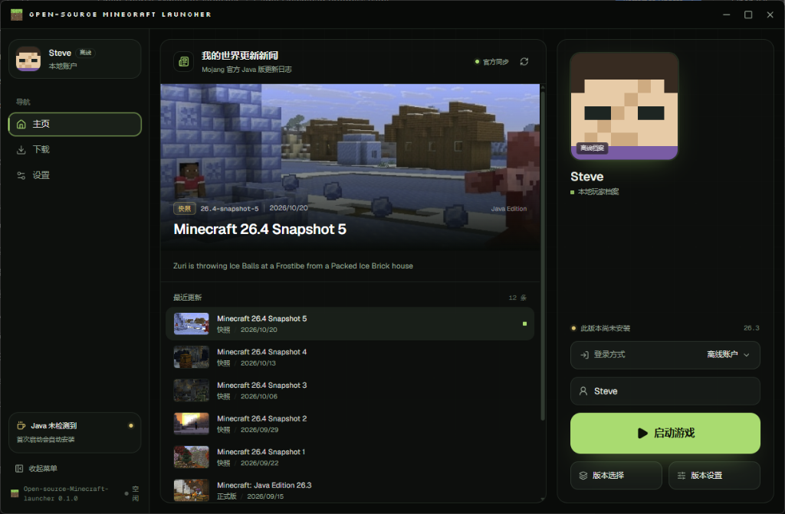
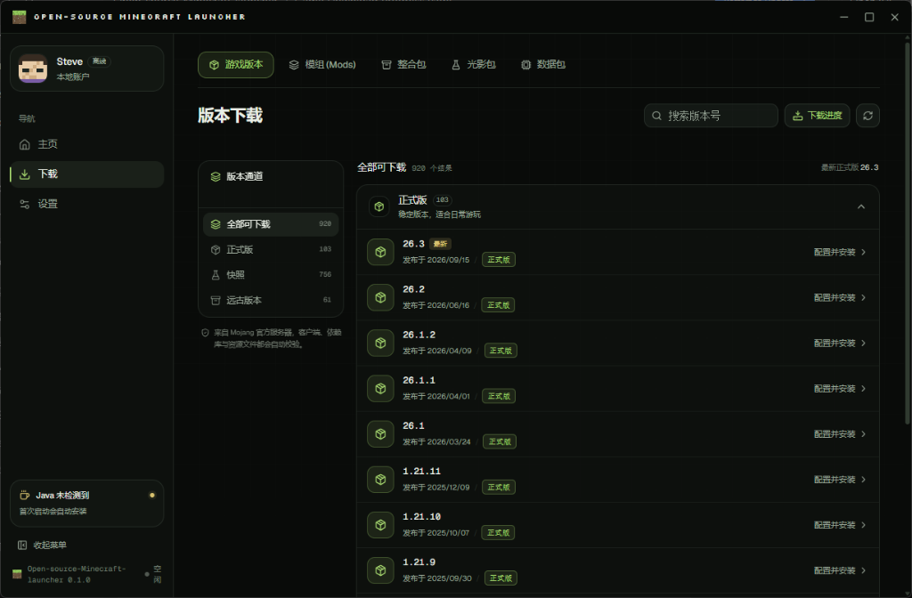
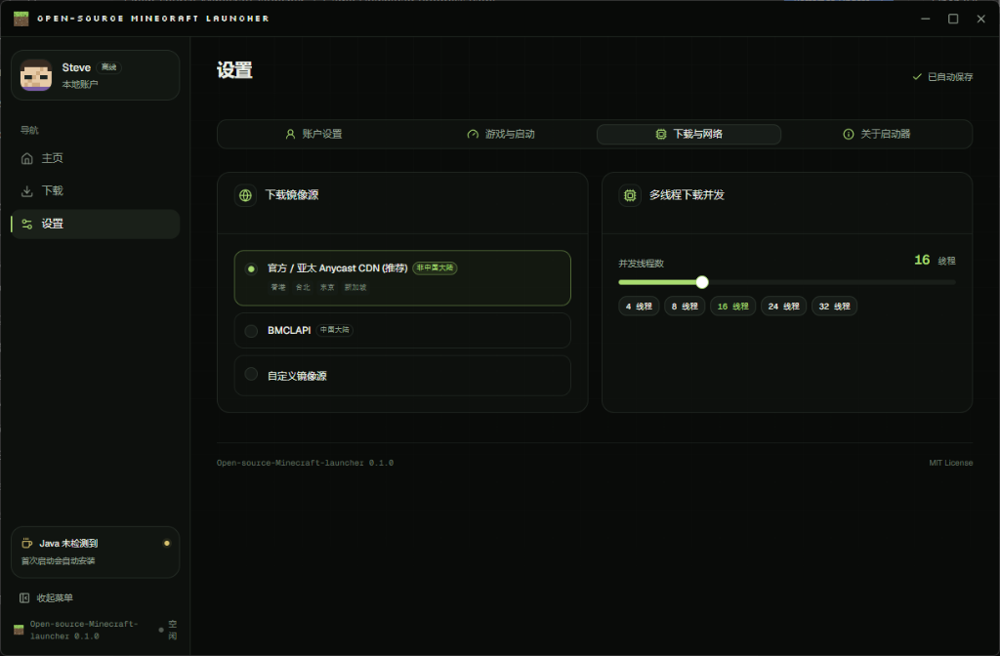
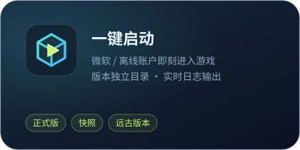
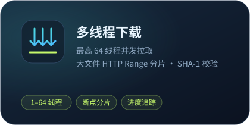
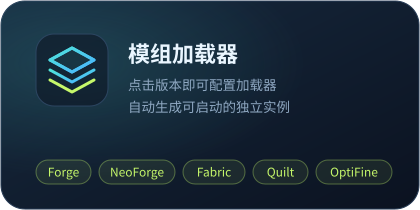
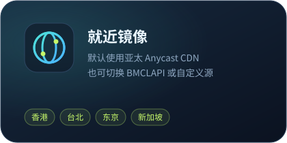
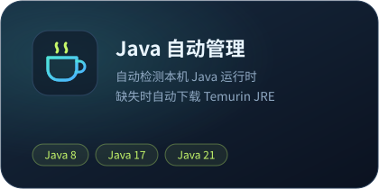

<div align="center">


# Open-source-Minecraft-launcher

一个轻量、现代的高性能开源 Minecraft 启动器（原生支持 Java 版与基岩版双架构）

基于 **Tauri 2 · Rust · React 19** 构建

[](LICENSE)


</div>

---

## 截图

<table>
  <tr>
    <td colspan="2"></td>
  </tr>
  <tr>
    <td></td>
    <td></td>
  </tr>
</table>

## 核心功能

<table>
  <tr>
    <td></td>
    <td></td>
  </tr>
  <tr>
    <td></td>
    <td></td>
  </tr>
  <tr>
    <td></td>
    <td></td>
  </tr>
</table>

### ▶ 智能游戏启动与设置
- **版本核心自动识别**：智能检测所选版本的启动架构与依赖，无需手动选择启动核心。
- **独立版本配置**：每个实例均支持独立设置最大/最小内存、窗口大小与全屏、JVM 参数、环境变量覆盖、进程优先级（高/正常/低）以及启动器关闭/最小化行为。
- **古老版本兼容**：BetaCraft 归档的 Classic / Indev / Infdev / Alpha / Beta 与 1.6 及更早的 Mojang 版本会过滤空的分辨率占位参数（`--width` / `--height`），并且只向旧模板补充它声明过的启动参数；同时按需填入 LegacyFix 的窗口图标变量，避免 `Failed launch main class` 这类启动前闪退。
- **实时控制台**：游戏标准输出与错误日志实时投递至日志面板，支持 ANSI 染色与一键导出。
- **资源包与地图管理器**：版本设置新增「资源包管理」「地图管理」两个面板。Java 版的资源包开关直接改写 `options.txt` 的 `resourcePacks` 列表（与游戏内「选项 → 资源包」严格同步，不再靠改文件名假装停用），存档目录随「版本隔离」在 `versions/<id>/saves` 与共享根目录 `saves` 之间切换，支持 `.zip` / 文件夹导入与整份删除；基岩版从每个 `com.mojang` 读取 `resource_packs` 与 `minecraftWorlds`，导入 `.mcworld` 会写入全部数据目录，删除也会清理所有副本。
- **PCL2 风格快捷方式**：Java 版概览页提供「版本文件夹 / 存档文件夹 / Mod 文件夹 / 截图文件夹」四个入口，目录不存在时自动创建。

### ⇊ 多线程下载引擎与断点续传
- **并发多线程下载**：线程数支持 1–64 级调节，针对大文件自动利用 HTTP Range 进行无损分片并发传输。
- **暂停、恢复与取消**：支持下载任务实时暂停与恢复；软件关闭时自动保留断点而非丢失，彻底杜绝安装失败后的残留垃圾文件。
- **多镜像透明容灾 (防 404)**：遇到网络丢包或 HTTP 404 时，底层自动毫秒级故障转移（官方源、BMCLAPI、Fabric/Forge/NeoForge Maven、10 大 Xbox Live CDN 节点无缝轮询），确保 100% 下载成功率。
- **模组与资源包同引擎**：Java 模组、资源包、光影、数据包以及基岩版附加包的下载都改走统一的 `download_file_with_mirrors`（分片并发、原子 `.part` 写入、SHA-1 校验、镜像回退），并沿用设置里的并发线程数与选定的下载源，不再单独开一套简化下载逻辑。
- **下载源真实生效与测速**：设置里选择的官方 / BMCLAPI / 自定义镜像会通过 `set_download_preference` 下发到 Rust，实际改变版本清单与游戏文件的候选顺序（失败仍自动回退）。「测速」按钮分别请求三个源的版本清单，显示首字节延迟与「最快」标记，可一键切换到最快源；自定义镜像按 BMCLAPI 兼容路径重写，并校验必须为 http(s) 地址。

### ✦ 界面个性化
- **背景**：只有「无背景」与「自定义图片」两档，不再附带预设壁纸。选本地图片或网络 URL 作为窗口壁纸，模糊度（0–24px）与不透明度（10–100%）实时生效。背景层固定在窗口本身而不是滚动容器内，因此在设置页往下滚动后再换图也能立即看到变化。
- **背景与透明度**：壁纸选项、路径、模糊度、背景不透明度与界面不透明度合并在同一块面板里，不再分两节。界面不透明度（30–100%）作用于全部界面表面（卡片、侧边栏、标题栏、弹窗、输入框与下拉菜单）：所有面板颜色都由 `--surface-alpha` 统一派生，壁纸因此能透过每一层组件显示，而不只是主区域。下拉菜单、选择器与 tooltip 这类浮层不参与淡出，始终使用实色 `--popover`，否则选项后面的表单文字会透出来。窗口本身仍有不透明底层，不会透出桌面。
- **强调色与外观模式**：强调色只有一个自定义取色器（HEX 输入或调色板），不再提供预设色卡；外观模式保留深色 / 浅色 / 跟随系统。
- **排版与文案**：字体可选现代极简（Geist Sans）、复古像素（Silkscreen）、系统原生或古典衬线，并支持界面字重（400/500）与字间距（紧凑/标准/宽松）微调；窗口标题、个性标语、首页状态文案与启动按钮文案都可自定义，留空即用默认措辞。

### ◈ 双架构模组加载器生态

#### Java 版模组生态
- 支持一键安装与配置 **Forge / NeoForge / Fabric / Quilt** 及 **OptiFine**、Fabric API 等附加组件，自动处理兼容性与依赖互斥。

#### 基岩版（Bedrock）模组生态（基于 BedrockBoot 架构标准）
- **LeviLamina 模组加载器**：接入官方 `levilamina-client-version-db` 数据库，自动匹配并一键下载部署官方最新或指定版本的 LeviLamina 加载器。
- **Amethyst 客户端加载器**：支持原生 C++ 客户端 Mod 注入框架。
- **原生 DLL 模组管理 (DllMods)**：遵循 BedrockBoot 目录与配置规范，支持原生 `.dll` 模组、LeviLamina 插件与行为包的一键启停（`.disabled` 切换）、删除与本地导入。
- **基岩版附加包管理器**：选中基岩版后，版本设置里的「附加包管理」不再打开 Java 的 `versions/<id>/mods`，而是直接扫描所有已存在的 `com.mojang` 数据目录（便携目录 / GDK / UWP），按资源包、行为包、皮肤包、世界模板分组，展示 `manifest.json` 里的名称、UUID、版本、简介与 `pack_icon.png` 图标。停用会把包移动到同目录的 `cobble_disabled_packs`（游戏不再加载、文件仍然保留），另支持批量启停、删除（仅限包目录内部路径）以及 `.mcpack` / `.mcaddon` / `.mcworld` / `.zip` 的本地导入——导入复用与下载安装相同的解包逻辑，写入每一个已存在的数据目录。

### ❖ 基岩版环境管理 (Bedrock Edition)
- **首次启动依赖自检**：所有基岩版启动路径（商店客户端、`.msixvc` 加密包、AppX、BDS 独立核心）都会在启动前自检运行依赖；Xbox GDK 路径会通过 winget 自动静默补齐「Xbox 应用」与「游戏服务」，随后直接唤起游戏，无需手动排查。
- **UWP / AppX 核心不经过 Microsoft Store**：下载得到的 UWP 核心由启动器自行解包，并按 BedrockBoot 的方式以开发模式在本机注册（`Add-AppxPackage -Register`，不带 `-DisableDevelopmentMode`），随后按应用标识唤起游戏；本机未安装的框架依赖会被自动跳过，不再回退到 `minecraft:` 协议或弹出商店安装页。安装包内的原始清单会保留为 `AppxManifest.factory.xml`。
- **Xbox GDK 加密包自动接管**：选中 `.msixvc` 加密核心时不再报错阻塞，启动器会自动探测并补齐运行依赖，随后直接唤起商店版客户端；若 winget 缺失或安装被拦截，会自动打开对应商店安装页。
- **85+ 款官方 Xbox Live CDN 实测直链**：集成高带宽原生直链，支持正式版与预览版极速下载安装。
- **离线账户核心策略**：离线账户启动基岩版时优先使用已安装的 BDS 独立核心；若只下载了 UWP/AppX 或 GDK 核心，则直接注册并唤起对应客户端（GDK 加密包自动补齐 Xbox 运行环境），不再强制改用 BDS；本机完全没有核心时才自动后台部署 BDS，无需手动选版本。
- **UWP / 独立核心多实例并存**：下载的 UWP/AppX 核心会以开发模式注册并直接启动，商店版 UWP 正版同样一键唤起，也可运行版本隔离的 AppX / BDS 独立核心。
- **附加包自动部署（对齐 BedrockBoot-DM）**：原生支持 `.mcpack` / `.mcaddon` / `.mcworld`。安装时逐个读取包内 `manifest.json`，按模块类型（`resources` → `resource_packs`，`data`/`script` → `behavior_packs`）分区解压，文件夹以「包名 + UUID」命名避免同名覆盖；`.mcaddon` 内嵌的 `.mcpack` 会递归安装，`.mcworld` 通过 `level.dat` 识别并导入 `minecraftWorlds`。安装结果会写入所有已存在的游戏数据目录（启动器便携目录、GDK `%APPDATA%\Minecraft Bedrock`、UWP `LocalState`），不再触发 Microsoft Store 的 `.mcpack` 文件关联。

### ▦ 资源市场
Java 版资源接入 Modrinth，可按游戏版本、加载器（Fabric/Forge/NeoForge/Quilt）和热度搜索模组、整合包、光影包与材质包，自动下载部署至目标实例目录。

**多语言搜索**：模组、整合包、光影、数据包与基岩版附加包的搜索框接受中文（含繁体）、日文、韩文与俄文关键词。后端 [search_i18n.rs](src-tauri/src/search_i18n.rs) 把「钠」「机械动力」「光影」「シェーダー」「셰이더」「шейдер」等术语映射成英文再查询 Modrinth / CurseForge（例如「钠」→ `sodium`、「机械动力 附属」→ `create addon`）；若换用英文后一条结果也没有，会自动回退到原始关键词，所以标题本身就是中文的项目不会被藏起来。搜索框下方会显示实际使用的英文关键词，替换过程完全可见。版本下载页的搜索框同样支持类型关键词：正式版 / 快照 / 愚人节 / Beta / 远古 / release / snapshot 等（中英文均可），April Fools 构建不会被「快照」搜索结果混入（它们归属自己的分组）。

版本选择页采用「版本胶囊 + 折叠分组」布局：顶部胶囊列出该项目支持的所有大版本（`全部` 与 `1.21`、`1.20` 等，点击即筛选，带本地已安装版本的分组默认展开），下方按 **加载器 + 游戏版本** 折叠分组（如 `NeoForge 1.21.4`，预发布/快照构建单独归入带 `预览版` 后缀的分组，且排在正式分组之后），每个构建一行，显示 `模组名 版本 for 加载器 版本`、文件名、下载次数、更新时间、文件大小，测试版/预览版会额外标注渠道。

下载 Java 模组时会自动挑选游戏版本（以及加载器）一致的本地实例，直接写入 `versions/<实例>/mods`。模组不再有「根目录 `mods/`」这个公共落点：那个目录游戏读不到，只会让人以为装好了却失效。每行右侧会直接显示落点（`<实例>/mods`）；本机没有对应版本时该行标注 `需先安装 <版本>` 并禁用下载按钮，装好版本后即可下载。旧版本留下的根目录 `mods/` 不再被读取或写入，空目录会自动清除。

项目头部的快捷操作会跟随数据源变化：

| 数据源 | 按钮 |
| --- | --- |
| Modrinth（Java 模组 / 整合包 / 数据包 / 光影 / 材质） | **转到 Modrinth** · **转到 MC 百科**（模组、整合包、数据包）· **复制名称** |
| CurseForge（基岩版附加包 / 材质包） | **转到 CurseForge** · **复制名称**（MC 百科没有基岩版条目，自动隐藏） |

**转到 MC 百科** 不再只是丢一个搜索页：后端 [mcmod.rs](src-tauri/src/mcmod.rs) 会按 PCL2 的思路定位具体条目 ID（`/class/<id>.html` 或 `/modpack/<id>.html`），只接受英文名、方括号缩写或整个标题与项目 slug 完全一致的结果（因此 `Sodium` 不会误跳到 `Sodium Extra`，`Create` 也不会跳到它的附属），查不到时才退回 `search.mcmod.cn` 并标注「在 MC 百科搜索」。查询只在该页面打开时进行一次，结果按会话缓存。

桌面端的外链由 `open_url` 命令交给系统浏览器（仅允许 `http/https`，失败时按平台回退到 `start` / `open` / `xdg-open`），浏览器预览则新开标签页；**复制名称** 优先用剪贴板 API，被 WebView 拒绝时回退到隐藏文本框方案。

基岩版附加包接入 **CurseForge 基岩版目录**（`gameId=78022`，附加包 `classId=4984`、材质包 `classId=6929`），与 BedrockBoot-DM 使用同一套接口：

| 用途 | 接口 |
| --- | --- |
| 搜索项目 | `GET {base}/v1/mods/search?gameId=78022&classId=…&searchFilter=…&sortField=…&index=…&pageSize=…` |
| 文件列表 | `GET {base}/v1/mods/{modId}/files?index=0&pageSize=50` |
| 下载直链 | 文件记录中的 `downloadUrl`，缺失时回退 `GET {base}/v1/mods/{modId}/files/{fileId}/download-url` |

`{base}` 默认使用免密钥镜像 `https://mod.mcimirror.top/curseforge/`；配置环境变量 `CURSEFORGE_API_KEY`（或 `COBBLE_CURSEFORGE_API_KEY`）后会优先使用官方 `https://api.curseforge.com/`（携带 `x-api-key`）。下载的文件按上述附加包规则解包安装，因此搜索 → 选文件 → 安装全程无需打开浏览器或 Microsoft Store。

### ☕ 智能运行时环境
启动前根据 Minecraft 版本规范自动匹配系统已安装的 Java 版本；首次启动若缺失对应 Java，会自动下载并部署 Eclipse Temurin JRE / JDK 后继续启动，无需手动干预。

### ❖ 关于与开源致谢
「关于启动器」展示当前版本、运行环境，以及最核心的开源项目（Tauri、Rust、React、Vite、Tailwind CSS、BedrockBoot-DM）与数据/镜像来源（Mojang、BMCLAPI、Modrinth、CurseForge、MC百科）。每条都带本地打包的项目图标、许可证与主页链接，点击即可在系统浏览器打开；完整依赖仍以 `package.json` / `Cargo.toml` 为准。图标均随包内置（`public/icons/credits/`），离线也能显示，版权归各项目所有，仅用于署名。当前版本 **0.0.7**（三份清单保持一致）。

---

## 快速开始

### 环境要求

- [Node.js](https://nodejs.org/) 20+
- [Rust](https://www.rust-lang.org/tools/install) stable
- [Tauri 2 系统依赖](https://v2.tauri.app/start/prerequisites/)

### 开发运行

```bash
git clone https://github.com/<your-name>/Open-source-Minecraft-launcher.git
cd Open-source-Minecraft-launcher
npm install
npm run tauri dev
```

### 构建打包

```bash
npm run tauri build
```

打包产物输出在 `src-tauri/target/release/bundle/`。

### 测试验证

```bash
npm run build
cargo test --manifest-path src-tauri/Cargo.toml
```

---

## 目录结构

```
├── src/                     # 前端 (React 19 + TypeScript + Tailwind CSS)
│   ├── components/          # 视图与交互组件
│   │   ├── BedrockModLoaderModal.tsx # 基岩版加载器与 DLL 模组管理器
│   │   ├── BedrockPackManager.tsx    # 基岩版附加包（资源包/行为包）管理器
│   │   ├── JavaPackManager.tsx       # Java 资源包管理器（写入 options.txt）
│   │   ├── JavaShortcuts.tsx         # PCL2 风格版本目录快捷方式
│   │   ├── WorldManager.tsx          # Java / 基岩版地图（存档）管理器
│   │   ├── VersionSettingsView.tsx   # 版本独立启动设置面板
│   │   ├── DownloadCatalogView.tsx   # 版本与核心下载目录
│   │   └── ui/              # shadcn/ui 基础组件
│   └── lib/                 # 类型定义、IPC 桥接、设置存储
└── src-tauri/               # 后端 (Rust + Tauri 2)
    └── src/
        ├── minecraft.rs     # Java 版版本清单、资产下载、启动进程
        ├── loaders.rs       # Java 版模组加载器安装与解析
        ├── bedrock.rs       # 基岩版检测、Xbox CDN 直链、LeviLamina/模组加载与管理
        ├── content.rs       # 资源市场搜索与下载
        ├── search_i18n.rs   # 多语言搜索词表（中文/日文/韩文/俄文 → 英文）
        ├── java.rs          # Java 运行时检测与自动部署
        ├── net.rs           # 多线程分片并发下载、多镜像容灾与断点续传引擎
        └── lib.rs           # Tauri 命令暴露与事件分发
```

游戏数据默认保存在 `~/.cobble/`（或自定义游戏根目录）。

---

## 许可证

本项目基于 [MIT License](LICENSE) 开源。

> Minecraft 是 Mojang Studios 的商标。本项目与 Mojang 及 Microsoft 无任何关联。
