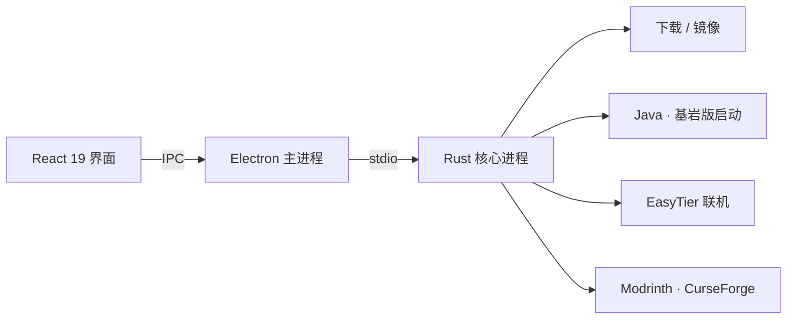
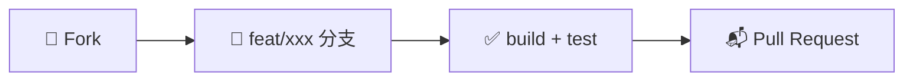

<div align="center">


# Open-source-Minecraft-launcher

**轻量 · 现代 · 开源的 Minecraft 启动器**

Java 版 × 基岩版 · 一个应用全搞定

<p>
  <a href="https://github.com/Cerlesse-studio/Open-source-Minecraft-launcher/releases"></a>
  <a href="LICENSE"></a>
  <a href="https://github.com/Cerlesse-studio/Open-source-Minecraft-launcher/stargazers"></a>
</p>

<p>
  
  
  
  
  
  
</p>

<p>
  
  
  
</p>

[✨ 特性](#-特性) · [🖼️ 预览](#️-预览) · [🚀 快速开始](#-快速开始) · [🏗️ 架构](#️-架构) · [❓ FAQ](#-faq) · [🤝 贡献](#-贡献)

</div>

---

## ✨ 特性

<table>
  <tr>
    <td align="center" width="33%">🎮<br /><b>双版本统一</b><br /><sub>Java + 基岩版共用版本库</sub></td>
    <td align="center" width="33%">⚡<br /><b>高速下载</b><br /><sub>分片并发 · 断点续传 · 多镜像</sub></td>
    <td align="center" width="33%">🌐<br /><b>零配置联机</b><br /><sub>EasyTier P2P · 分享码加入</sub></td>
  </tr>
  <tr>
    <td align="center">🔐<br /><b>双账户</b><br /><sub>微软正版 · 离线 + 自定义皮肤</sub></td>
    <td align="center">🧩<br /><b>全加载器</b><br /><sub>Forge · NeoForge · Fabric · Quilt</sub></td>
    <td align="center">☕<br /><b>Java 自动管理</b><br /><sub>缺失自动部署 Temurin</sub></td>
  </tr>
  <tr>
    <td align="center">🛒<br /><b>内容市场</b><br /><sub>Modrinth · CurseForge</sub></td>
    <td align="center">🔎<br /><b>多语言搜索</b><br /><sub>中 / 日 / 韩 / 俄 关键词映射</sub></td>
    <td align="center">🎨<br /><b>深度个性化</b><br /><sub>主题 · 壁纸 · PCL2 主页</sub></td>
  </tr>
</table>

<details>
<summary><b>📋 功能支持矩阵</b></summary>

| 功能 | Windows | macOS | Linux |
| :-- | :-: | :-: | :-: |
| Java 版启动 / 下载 | ✅ | ✅ | ✅ |
| 模组加载器（Forge / Fabric …） | ✅ | ✅ | ✅ |
| 微软正版登录 | ✅ | ✅ | ✅ |
| 远古版本（Classic / Alpha / Beta） | ✅ | ✅ | ✅ |
| 基岩版（GDK / UWP / BDS） | ✅ | ❌ | ❌ |
| LeviLamina / Amethyst | ✅ | ❌ | ❌ |
| EasyTier 联机 | ✅ | ⚠️ | ⚠️ |

<sub>✅ 支持 · ⚠️ 可构建，未完整测试 · ❌ 不支持</sub>

</details>

## 🖼️ 预览

<table>
  <tr>
    <td colspan="2" align="center"><br /><sub>🏠 主页 · 新闻 · 一键启动</sub></td>
  </tr>
  <tr>
    <td align="center" width="50%"><br /><sub>⬇️ 下载中心</sub></td>
    <td align="center" width="50%"><br /><sub>⚙️ 设置</sub></td>
  </tr>
</table>

<table>
  <tr>
    <td align="center" width="50%"></td>
    <td align="center" width="50%"></td>
  </tr>
  <tr>
    <td align="center"></td>
    <td align="center"></td>
  </tr>
  <tr>
    <td align="center"></td>
    <td align="center"></td>
  </tr>
</table>

## 🚀 快速开始

### 📦 下载安装

<a href="https://github.com/Cerlesse-studio/Open-source-Minecraft-launcher/releases"></a>

> [!NOTE]
> 需要 **Windows 10 / 11 x64**，无需安装 WebView2。暂不支持 Windows 7 / 8 / 8.1。

### 🛠️ 源码构建

| 依赖 | 版本 |
| :-- | :-- |
|  | 20.19+ |
|  | 1.85+ |

```bash
git clone https://github.com/Cerlesse-studio/Open-source-Minecraft-launcher.git
cd Open-source-Minecraft-launcher
npm ci
npm run start            # 开发模式
npm run electron:build   # 打包 → release/
```

<details>
<summary><b>🧪 检查与测试</b></summary>

```bash
npm run build                                                        # 类型检查 + 前端构建
cargo fmt    --manifest-path src-tauri/Cargo.toml -- --check         # 格式
cargo clippy --manifest-path src-tauri/Cargo.toml --all-targets -- -D warnings
cargo test   --manifest-path src-tauri/Cargo.toml                    # 单元测试
```

</details>

## 🏗️ 架构



<details>
<summary><b>📁 目录结构</b></summary>

| 路径 | 职责 |
| :-- | :-- |
| `src/` | React 界面 |
| `electron/` | 主进程 · 预加载 · 开发启动脚本 |
| `src-tauri/src/minecraft.rs` | Java 版清单与启动 |
| `src-tauri/src/loaders.rs` | 模组加载器安装 |
| `src-tauri/src/net.rs` | 分片下载与镜像 |
| `src-tauri/src/bedrock.rs` | 基岩版部署 |
| `src-tauri/src/content.rs` | 内容市场 |
| `src-tauri/src/multiplayer.rs` | EasyTier 联机 |
| `src-tauri/src/auth.rs` · `java.rs` | 账户与 Java |

<sub>`src-tauri/` 仅为沿用的 Rust 工程路径，运行时已不再使用 Tauri。</sub>

</details>

## ❓ FAQ

<details>
<summary><b>🔐 必须有正版账号吗？</b></summary>

不需要。离线账户可玩单人与离线服务器；正版账户解锁正版服务器、皮肤与基岩版。
</details>

<details>
<summary><b>☕ 没装 Java 怎么办？</b></summary>

启动时自动下载匹配的 Temurin JRE 到 `<游戏目录>/runtime/`。
</details>

<details>
<summary><b>💾 存档在哪？如何备份？</b></summary>

默认 `~/.cobble`，直接复制整个目录即可。
</details>

<details>
<summary><b>🌐 联机需要什么？</b></summary>

双方具备公网 IPv6，房主放行 UDP/TCP `11010` 端口。无需管理员权限。
</details>

<details>
<summary><b>⚠️ 已知限制</b></summary>

- 基岩版仅限 Windows
- 未代码签名，SmartScreen 提示时请确认来源后放行
- PCL2 主页部分复杂动画暂不支持
</details>

## 🤝 贡献



欢迎 [提交 Issue](https://github.com/Cerlesse-studio/Open-source-Minecraft-launcher/issues) 或 PR，界面改动请附截图。

## 💖 致谢

<p>
  <a href="https://www.electronjs.org/"></a>
  <a href="https://react.dev"></a>
  <a href="https://easytier.cn"></a>
  <a href="https://github.com/0x44614D696E67/BedrockBoot-DM"></a>
  <a href="https://github.com/bangbang93/BMCLAPI"></a>
  <a href="https://modrinth.com"></a>
  <a href="https://www.curseforge.com"></a>
  <a href="https://betacraft.uk"></a>
  <a href="https://www.mcmod.cn"></a>
</p>

---

<div align="center">

<sub>📄 [MIT License](LICENSE) · Minecraft 是 Mojang Studios 的商标，本项目与 Mojang / Microsoft 无关，不分发游戏本体。</sub>

</div>
