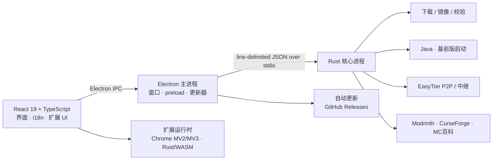
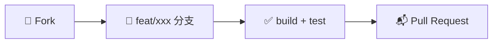

<div align="center">


# Open-source-Minecraft-launcher

**轻量 · 现代 · 开源的 Minecraft 启动器**

Java 版 × 基岩版 · 一个应用全搞定

<p>
  <a href="https://github.com/Cerlesse-studio/Open-source-Minecraft-launcher/releases"></a>
  <a href="LICENSE"></a>
  <a href="https://github.com/Cerlesse-studio/Open-source-Minecraft-launcher/stargazers"></a>
</p>

<p>
  
  
  
  
  
  
</p>

<p>
  
  
  
</p>

[✨ 特性](#-特性) · [🖼️ 预览](#️-预览) · [🚀 快速开始](#-快速开始) · [🧩 扩展](#-扩展系统) · [🌐 联机](#-联机网络) · [🏗️ 架构](#️-架构) · [❓ FAQ](#-faq) · [🤝 贡献](#-贡献)

</div>

---

> [!TIP]
> **0.1.4 重点更新**：扩展系统（Chrome MV2/MV3 + 原生 Rust/WASM）、中英双语界面、纯 IPv6 P2P / 公益节点双模式、房间资源克隆、OTA 自动更新、Linux BDS、macOS MCPELauncher 与版本级个性化。

## ✨ 0.1.4 更新

| 更新 | 说明 |
| :-- | :-- |
| 🧩 **扩展系统** | 支持启动器原生扩展（JavaScript + Rust/WASM）与 Chrome Manifest V2 / V3 扩展；安装 `.zip` / `.crx` / 已解压目录，可启停、导出、卸载。 |
| 🌍 **中英双语** | 界面可在简体中文与 English 之间即时切换，设置会持久保存。 |
| 🌐 **联机双模式** | 默认纯 IPv6 P2P 直连；没有公网 IPv6 时可切换公益节点模式，由 EasyTier 协助节点打洞与多线路中继。 |
| 📦 **房间资源克隆** | 访客可以按房主的游戏版本与资源清单，一键克隆模组、光影与数据包，减少「进得去但进不了世界」的版本差异。 |
| ⬆️ **OTA 自动更新** | 在设置中检查 GitHub Releases、查看更新说明、下载并安装更新；Windows 单文件 / 安装包与 Linux AppImage 可自动替换，macOS 打开 DMG 完成安装。 |
| 🖥️ **跨平台补全** | Linux 支持 Mojang 官方 `bin-linux` BDS 服务端；macOS 可接管已安装的 MCPELauncher 客户端，Java 版与联机覆盖三平台。 |
| 🎨 **版本级个性化** | 每个版本可设置独立图标、分类、别名、描述并加入收藏夹。 |

## 🖼️ 预览

<table>
  <tr>
    <td colspan="2" align="center"><br /><sub>🏠 主页 · 官方动态、当前版本、账户状态与一键启动</sub></td>
  </tr>
  <tr>
    <td align="center" width="50%"><br /><sub>⬇️ 下载中心 · 全版本、加载器与内容市场</sub></td>
    <td align="center" width="50%"><br /><sub>⚙️ 设置 · 镜像、并发、Java 与外观</sub></td>
  </tr>
  <tr>
    <td align="center" width="50%"><br /><sub>🧱 实例设置 · 独立目录、内存与 JVM 参数</sub></td>
    <td align="center" width="50%"><br /><sub>📈 运行监控 · 进程状态、资源占用与日志</sub></td>
  </tr>
</table>

## ✨ 特性

<table>
  <tr>
    <td align="center" width="33%">🎮<br /><b>双版本统一</b><br /><sub>Java + 基岩版共用版本库</sub></td>
    <td align="center" width="33%">⚡<br /><b>高速下载</b><br /><sub>分片并发 · 断点续传 · 多镜像</sub></td>
    <td align="center" width="33%">🌐<br /><b>联机双模式</b><br /><sub>纯 IPv6 P2P · 公益节点中继</sub></td>
  </tr>
  <tr>
    <td align="center">🔐<br /><b>双账户</b><br /><sub>微软正版 · 离线 + 自定义皮肤</sub></td>
    <td align="center">🧩<br /><b>全加载器</b><br /><sub>Forge · NeoForge · Fabric · Quilt</sub></td>
    <td align="center">🛒<br /><b>内容市场</b><br /><sub>模组 · 光影 · 地图 · 整合包</sub></td>
  </tr>
  <tr>
    <td align="center">🧱<br /><b>扩展系统</b><br /><sub>Chrome MV2/MV3 · Rust/WASM</sub></td>
    <td align="center">🌍<br /><b>中英双语</b><br /><sub>界面即时切换</sub></td>
    <td align="center">⬆️<br /><b>自动更新</b><br /><sub>GitHub Releases · OTA</sub></td>
  </tr>
  <tr>
    <td align="center">☕<br /><b>Java 自动管理</b><br /><sub>缺失自动部署 Temurin</sub></td>
    <td align="center">🎨<br /><b>深度个性化</b><br /><sub>主题 · 壁纸 · PCL2 主页</sub></td>
    <td align="center">🖥️<br /><b>跨平台基岩版</b><br /><sub>Linux BDS · macOS MCPELauncher</sub></td>
  </tr>
</table>

<details>
<summary><b>📋 功能支持矩阵</b></summary>

| 功能 | Windows | macOS | Linux |
| :-- | :-: | :-: | :-: |
| Java 版启动 / 下载 | ✅ | ✅ | ✅ |
| 模组加载器（Forge / Fabric …） | ✅ | ✅ | ✅ |
| 微软正版登录 | ✅ | ✅ | ✅ |
| 远古版本（Classic / Alpha / Beta） | ✅ | ✅ | ✅ |
| 基岩版客户端（GDK / UWP / 商店） | ✅ | ❌ | ❌ |
| 基岩版 BDS 独立核心 | ✅ | ❌ | ✅ |
| MCPELauncher 客户端 | ❌ | ✅ | ✅ |
| LeviLamina / Amethyst | ✅ | ❌ | ❌ |
| EasyTier 联机（P2P / 公益节点） | ✅ | ⚠️ | ⚠️ |
| 扩展系统 | ✅ | ✅ | ✅ |
| 界面语言（中文 / English） | ✅ | ✅ | ✅ |
| 自动更新 | ✅ | ⚠️ | ⚠️ |

<sub>✅ 支持 · ⚠️ 已实现，未在真机完整回归 · ❌ 不支持。Linux BDS 对应 Mojang 官方 <code>bin-linux</code>（Ubuntu x86_64）；macOS 没有官方基岩版运行时，只接管系统已安装的 MCPELauncher 客户端；macOS 自动更新会打开 DMG，由用户完成安装。</sub>

</details>

## 🚀 快速开始

### 📦 下载安装

<a href="https://github.com/Cerlesse-studio/Open-source-Minecraft-launcher/releases"></a>

> [!NOTE]
> 当前源码版本为 **0.1.4**。GitHub Releases 的安装包可能滞后于仓库代码；以 Releases 页面实际提供的版本为准，或按下方方式从源码构建。
>
> Windows 10 / 11 无需安装 WebView2；Electron 自带 Chromium。暂不支持 Windows 7 / 8 / 8.1。
>
> macOS（Intel / Apple Silicon）与 Linux（x86_64 / aarch64）可运行 Java 版与 EasyTier 联机；Linux 还支持官方 BDS 服务端，macOS 支持已安装的 MCPELauncher 客户端。

### 🛠️ 源码构建

| 依赖 | 版本 |
| :-- | :-- |
|  | 20.19+ 或 22.12+ |
|  | 1.85+（edition 2024） |
| Electron | 22（随项目安装，无需单独配置） |

```bash
git clone https://github.com/Cerlesse-studio/Open-source-Minecraft-launcher.git
cd Open-source-Minecraft-launcher
npm ci
npm run start            # 开发模式（Electron + Rust 核心）
```

一键打包安装包与 OTA 更新文件：

```bash
npm run package          # 当前平台：安装包 + OTA 元数据
npm run package:win      # Windows：NSIS + 免安装版
npm run package:mac      # macOS：DMG + ZIP
npm run package:linux    # Linux：AppImage
npm run package:ota      # 只重建 OTA 清单与校验文件
```

产物位于 `release/v<版本>/`，包含带版本号的安装包、`latest*.yml`、`latest.json` 与 `SHA256SUMS.txt`。将整个目录上传到同名 GitHub Release（如 `v0.1.4`）即可用于 OTA 更新。

> 安装包会内嵌 Rust 核心，macOS 打包还需要 Apple 工具链，因此 Windows / macOS / Linux 必须分别在对应系统上构建。`electron:build:*` 仍可用于本机快速打包；首次构建会编译全部 Rust 依赖，耗时会明显更长。

<details>
<summary><b>🧪 检查与测试</b></summary>

```bash
npm run build                                                        # 类型检查 + 前端构建
npm test                                                             # 联机健康检查 / P2P 单元测试
cargo fmt    --manifest-path src-tauri/Cargo.toml -- --check         # 格式
cargo clippy --manifest-path src-tauri/Cargo.toml --all-targets -- -D warnings
cargo test   --manifest-path src-tauri/Cargo.toml                    # Rust 单元测试
cargo run    --manifest-path src-tauri/Cargo.toml --example smoke -- 1.8.9
```

</details>

## 🧩 扩展系统

扩展页面同时支持两种扩展，并安装到同一个目录：

- **启动器原生格式**：`manifest.json` + 可选 `background.js` + 可选 `plugin.wasm`（Rust/WASM 协处理器），可提供 `popup.html` 或独立标签页。
- **Chrome 扩展格式**：Manifest V2 / V3；读取 `action.default_popup` / `browser_action.default_popup`、`background.service_worker` / `background.scripts`、`_locales` 等字段，提供 `chrome.storage`、`chrome.runtime` 消息、`chrome.notifications` 与 `chrome.i18n` 常用子集。

支持安装 `.zip` / `.crx`、载入已解压目录、生成内置示例、启用 / 停用、导出 ZIP 与卸载；扩展控制台会记录后台脚本 `console` 输出、消息处理与 Rust 调用。

- 安装位置：`<游戏目录>/extensions/`（未配置游戏目录时为 `~/.cobble/extensions/`）。
- **安全边界**：扩展在启动器界面进程里执行 JavaScript，**不是浏览器级沙箱**；`.crx` 只剥离容器头，不校验 Chrome 签名链。请只安装可信来源的扩展。
- **兼容范围**：没有网页上下文，不支持 content script、tabs / windows、网络拦截与页面脚本注入；权限字段仅作展示。
- 完整开发指南与 API 对照：[docs/extensions.md](docs/extensions.md)。

## 🌐 联机网络

联机以内置 [EasyTier](https://easytier.cn) v2.6.4 为内核，提供两种路径：

### 纯 IPv6 P2P（默认）

- 房主分享码 + 访客回执码交换入口；双方同时向对方的公网 IPv6 发包，强制 P2P。
- 启动器不联系 STUN、信令或中继，游戏流量只经过两台电脑。
- 需要双方都有公网 IPv6，并放行本机 TCP/UDP `11010`；路由器 IPv6 防火墙若直接丢弃入站包，需要在路由器放行或改用公益节点模式。

### 公益节点模式（可选）

- 没有公网 IPv6，或运营商 / 路由器禁止入站 UDP 时使用。
- 由 EasyTier 协助节点帮助打洞，并在无法直连时提供多线路中继；房主监听端口可不对外开放。
- 支持自动优选延迟最低的节点，也可手动指定节点；节点列表可从 `info.qtet.cn` 社区监控同步，并支持自建节点、批量测速与保存。

### 房间资源与发现

- 房间页会列出房主版本的模组、光影、数据包与资源包；访客可勾选并克隆房主的游戏版本、模组、光影与数据包，同名文件会覆盖。
- 「显示到局域网」会在本机启动 TCP 代理并向 `224.0.2.60:4445` 广播，好友世界会直接出现在「多人游戏 → 局域网」。
- 房间健康监控会检测房主是否离开；意外断开时自动退出或提示重连。

完整网络方案与排障：[docs/multiplayer-network.md](docs/multiplayer-network.md)。

## 🎨 个性化

- **版本级个性化**：每个版本可设置预设像素图标或本地图片、分类、别名与描述，并加入收藏夹。
- **全局外观**：深色 / 浅色 / 跟随系统、自定义强调色、本地 / 网络壁纸、背景与界面不透明度、字体与字间距。
- **自定义主页**：内置更新新闻、空白、本地 HTML / PCL2 `.xaml` 或联网主页；支持自动刷新与常用 PCL2 控件。
- **中英双语**：界面语言可在简体中文与 English 之间即时切换。

## 🔄 自动更新

在「设置 → 关于启动器 → 软件更新」中检查 GitHub Releases：

- 自动比较版本并展示 Release 说明、更新包大小与下载进度。
- 下载缓存位于 Electron 用户数据目录的 `updates/`。
- Windows 单文件 / NSIS 与 Linux AppImage 可自动替换并重新启动；macOS 会打开 DMG，由用户完成安装。
- 只安装由启动器从官方 Releases 下载的更新包。

## 🏗️ 架构



<details>
<summary><b>📁 目录结构</b></summary>

| 路径 | 职责 |
| :-- | :-- |
| `src/` | React 界面、设置、i18n、扩展运行时与视图 |
| `electron/` | Electron 主进程、preload、后台日志窗口、更新器与打包脚本 |
| `src-tauri/src/minecraft.rs` | Java 版清单与启动 |
| `src-tauri/src/loaders.rs` | 模组加载器安装 |
| `src-tauri/src/net.rs` | 分片下载、镜像容灾与续传 |
| `src-tauri/src/auth.rs` · `java.rs` | 微软账户与 Java 运行时 |
| `src-tauri/src/content.rs` | Modrinth / CurseForge 内容市场 |
| `src-tauri/src/bedrock.rs` | Windows 基岩版、Linux BDS、macOS MCPELauncher |
| `src-tauri/src/multiplayer.rs` | EasyTier P2P / 公益节点、局域网广播与房间资源 |
| `src-tauri/src/extension.rs` | 扩展安装、清单解析、Chrome 兼容与 WASM |
| `src-tauri/src/bridge.rs` | Electron ↔ Rust 的 stdio JSON 桥 |
| `src-tauri/src/platform.rs` | 平台识别与系统兼容检查 |
| `src/lib/i18n.ts` | 中英双语文案与语言切换 |
| `src/lib/extensions.ts` | 扩展运行时与 `chrome.*` 兼容层 |
| `src/lib/multiplayerHealth.ts` | 房间健康监控 |
| `docs/` | 官网、截图、扩展开发与联机网络文档 |

<sub>`src-tauri/` 仅为沿用的 Rust 工程路径，运行时已不再使用 Tauri。</sub>

</details>

## ❓ FAQ

<details>
<summary><b>🔐 必须有正版账号吗？</b></summary>

不需要。离线账户可玩单人与离线服务器；正版账户解锁正版服务器、皮肤与基岩版授权检测。
</details>

<details>
<summary><b>☕ 没装 Java 怎么办？</b></summary>

启动时自动匹配版本所需的 Java 主版本；缺失时下载 Temurin JRE 到 `<游戏目录>/runtime/`。也可以在设置或版本设置里手动指定 Java。
</details>

<details>
<summary><b>🌐 联机没有公网 IPv6 怎么办？</b></summary>

默认的纯 IPv6 P2P 需要双方都有公网 IPv6。没有时可在创建房间页切换到「公益节点模式」，由 EasyTier 协助节点打洞并在需要时中继；这是可选第三方路径，不会在纯 P2P 失败时自动切换。
</details>

<details>
<summary><b>🧩 扩展安全吗？</b></summary>

扩展不是浏览器级沙箱，会在启动器渲染进程中执行 JavaScript，可以访问启动器 API；`.crx` 也不会校验 Chrome 签名链。请只安装可信来源的扩展。扩展系统的能力边界见 [扩展开发](docs/extensions.md)。
</details>

<details>
<summary><b>🖥️ macOS / Linux 能玩基岩版吗？</b></summary>

Windows 支持商店 / GDK / UWP 基岩版客户端与 BDS。Linux 支持 Mojang 官方 `bin-linux` BDS 服务端；macOS 没有官方基岩版运行时，只接管系统已安装的 MCPELauncher 客户端。三平台都可运行 Java 版与 EasyTier 联机。
</details>

<details>
<summary><b>⬆️ 如何更新启动器？</b></summary>

在「设置 → 关于启动器 → 软件更新」中检查 GitHub Releases。Windows 单文件 / 安装包与 Linux AppImage 可自动替换，macOS 会打开 DMG 由用户安装。更新包只接受官方 Releases 地址。
</details>

<details>
<summary><b>💾 存档在哪？如何备份？</b></summary>

默认 `~/.cobble`，直接复制整个目录即可。账户与更新缓存位于应用数据目录，不在游戏目录中。
</details>

<details>
<summary><b>⚠️ Windows 提示未知发布者？</b></summary>

当前构建未代码签名，SmartScreen 可能提示未知发布者。请核对下载来源或自行构建；不要从第三方链接绕过安全检查。
</details>

## ⚠️ 已知限制

- **扩展不是安全沙箱**：只安装可信扩展；Chrome 扩展仅兼容常用 API 子集，没有 content script、tabs、网络拦截等网页能力。
- **纯 P2P 依赖公网 IPv6**：公益节点模式需要第三方 EasyTier 节点，节点可用性与线路质量不由本项目保证。
- **macOS / Linux 未完整真机回归**：Java 版、EasyTier 与 Linux BDS 已实现；macOS 无官方 BDS，Linux BDS 仅官方 `bin-linux`（Ubuntu x86_64）。
- **预编译包可能滞后**：GitHub Releases 的版本可能落后于仓库 `0.1.4` 代码。
- **未代码签名**：Windows / macOS 可能提示未知发布者或无法验证开发者。
- **PCL2 主页为部分兼容**：无法还原的 XAML 元素会在主页标题旁标记，未支持的动作会提示「暂不支持」。

## 🤝 贡献



欢迎 [提交 Issue](https://github.com/Cerlesse-studio/Open-source-Minecraft-launcher/issues) 或 PR；界面改动请附截图，行为变更请同步更新 README、官网或相关文档。

## 💖 致谢

<p>
  <a href="https://www.electronjs.org/"></a>
  <a href="https://react.dev"></a>
  <a href="https://www.rust-lang.org"></a>
  <a href="https://vite.dev"></a>
  <a href="https://tailwindcss.com"></a>
  <a href="https://easytier.cn"></a>
  <a href="https://github.com/0x44614D696E67/BedrockBoot-DM"></a>
  <a href="https://github.com/bangbang93/BMCLAPI"></a>
  <a href="https://modrinth.com"></a>
  <a href="https://www.curseforge.com"></a>
  <a href="https://betacraft.uk"></a>
  <a href="https://www.mcmod.cn"></a>
</p>

完整第三方项目、字体、图标与许可证声明见 [官网开源声明](docs/credits.html) 或应用内「设置 → 关于启动器」。

官网源码位于 [docs/index.html](docs/index.html)；将 GitHub Pages 的发布目录设为 `/docs` 即可部署。技术文档还包括 [扩展开发](docs/extensions.md) 与 [联机网络方案](docs/multiplayer-network.md)。

---

<div align="center">

<sub>📄 [GNU GPL v3 或更高版本](LICENSE) · Minecraft 是 Mojang Studios 的商标，本项目与 Mojang / Microsoft 无关，不分发游戏本体。</sub>

</div>
